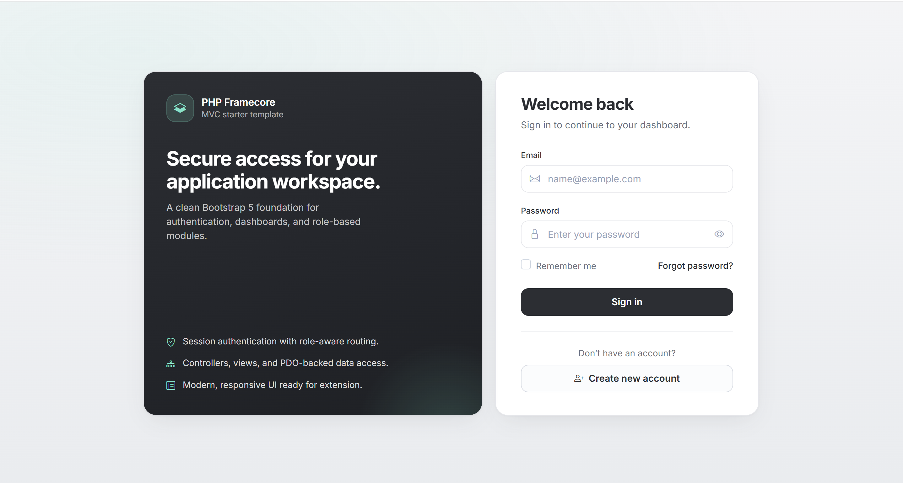
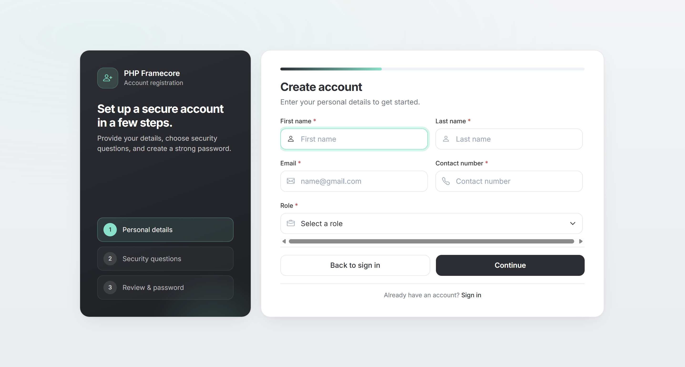
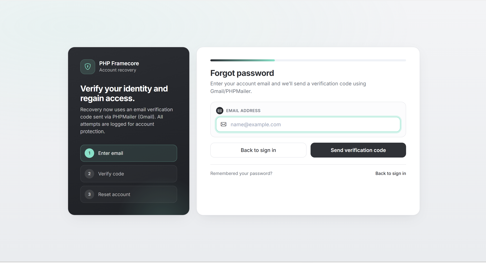

# PHP_Framecore

A lightweight, custom-built PHP framework with an MVC-like architecture.

## Screenshots

### Login Page


**What it shows:** The sign-in page (`app/views/auth/login.php`). A split-layout auth form with PHP Framecore branding on the left (tagline: "Secure access for your application workspace" and feature highlights), and a login form on the right with email and password fields (with show/hide toggle), "Remember me" checkbox, "Forgot password?" link, and a "Sign in" submit button. Footer links to the registration page for new users.

**What it's used for:** Users authenticate with their email and password. Supports password visibility toggle, session-based login, account lockout after 5 failed attempts (5-minute lock), and redirects to role-based dashboards (admin/staff/user) after successful login.

**URL:** `http://localhost:8000/index.php?action=login`

---

### Registration Page


**What it shows:** The account creation page (`app/views/auth/register.php`). A three-step wizard interface:
- **Step 1:** Personal details (first name, last name, email, contact number, role dropdown: admin/staff/user).
- **Step 2:** Security questions (5 questions/answers loaded from the database, used for account recovery).
- **Step 3:** Review & password (account summary preview, password field with strength meter, confirm password match check, terms agreement checkbox).

**What it's used for:** New users register an account with hashed password storage, 5 security questions/answers for recovery, email uniqueness validation, and automatic welcome email notification (if mail is configured). Admins are notified of new registrations.

**URL:** `http://localhost:8000/index.php?action=register`

---

### Forgot Password Page


**What it shows:** The account recovery page (`app/views/auth/forgot-password.php`). A three-step recovery flow:
- **Step 1:** Enter email address → sends a 6-digit verification code via PHPMailer (Gmail SMTP).
- **Step 2:** Enter the 6-digit code (expires in 15 minutes) → verifies identity.
- **Step 3:** Create a new password (with strength requirements: 8+ chars, uppercase, lowercase, number, special character) and confirm it.

**What it's used for:** Password reset via email verification code. Users who forgot their password can recover access by verifying their email, then setting a new password. Also supports email reset via the reset-options page. All attempts are logged for auditing.

**URL:** `http://localhost:8000/index.php?action=forgot-password`

---

## Description

PHP_Framecore is a simple PHP framework designed for small to medium-sized web applications. It features a straightforward, action-based routing system and a role-based access control mechanism. The framework is built with vanilla PHP, making it easy to understand and extend for developers familiar with core PHP.

## Features

- **MVC-like Architecture:** Separation of concerns with controllers, views, and a data access layer.
- **Action-Based Routing:** A simple routing system managed through a single front-controller (`index.php`).
- **Role-Based Access Control (RBAC):** Built-in support for multiple user roles (e.g., admin, staff, user) with permission handling.
- **Environment-Based Configuration:** Uses a `.env` file to manage environment-specific settings like database credentials.
- **Database Abstraction:** Utilizes PHP's PDO for database connectivity, supporting MySQL.
- **Basic Templating:** A simple view rendering system with a base layout structure.
- **Action Logging:** Includes a mechanism to log user actions for auditing purposes.

## Project Structure

```
.
├── app
│   ├── controllers            # Route handlers and business logic
│   │   ├── Auth/AuthController.php       # Authentication (login, register, forgot password, reset)
│   │   ├── Path/BaseController.php       # Base controller with shared helpers
│   │   ├── DashboardController.php       # Admin dashboard (legacy)
│   │   ├── Admin/AdminDashboardController.php
│   │   ├── Staff/StaffDashboardController.php
│   │   └── User/UserDashboardController.php
│   ├── models                 # Data access layer
│   │   └── User.php                  # User model (CRUD, security questions, login tracking)
│   ├── views                  # Presentation layer
│   └── middleware             # Request filters (currently empty)
├── config                     # Configuration files
│   ├── app.php                # Application configuration
│   ├── dbconn.php             # Database connection (PDO)
│   └── load_env.php           # Loads environment variables from .env
├── database                   # SQL schema
│   └── phpframecore.sql       # Database schema and seed data
├── public                     # Web root (document root)
│   ├── index.php              # Front controller / router
│   └── assets                 # Static assets (CSS, JS, images)
│       └── website
│           ├── loginaccount.png
│           ├── signupaccount.png
│           └── forgotaccount.png
├── .env                       # Environment variables (create from .env.example)
├── .gitignore
└── .htaccess                  # Apache rewrite rules for front-controller
```

## Installation and Setup

### Step 1: Clone the Repository

```bash
git clone https://github.com/BanSimplified567/PHP_Framecore.git
cd PHP_Framecore
```

### Step 2: Database Setup

1. **Create a MySQL database:**
   ```sql
   CREATE DATABASE phpframecore;
   ```

2. **Import the database schema:**
   ```bash
   mysql -u root -p phpframecore < database/phpframecore.sql
   ```
   
   Or using a GUI tool (phpMyAdmin, MySQL Workbench, etc.):
   - Open your database management tool
   - Select the `phpframecore` database
   - Import the `database/phpframecore.sql` file

3. **Verify the import:**
   ```sql
   USE phpframecore;
   SHOW TABLES;
   ```
   You should see tables like `users`, `roles`, `action_logs`, etc.

### Step 3: Configure Environment

1. **Create the `.env` file:**
   ```bash
   cp .env.example .env
   ```
   (If `.env.example` doesn't exist, create a new `.env` file manually)

2. **Update the `.env` file with your database credentials:**
   ```dotenv
   DB_HOST=localhost
   DB_USER=root
   DB_PASS=your_password_here
   DB_NAME=phpframecore
   DB_PORT=3306
   
   APP_ENV=development
   APP_DEBUG=true
   APP_URL=http://localhost:8000
   
   # Mail configuration (PHPMailer)
   MAIL_HOST=smtp.gmail.com
   MAIL_PORT=587
   MAIL_ENCRYPTION=tls
   MAIL_USERNAME=your_email@gmail.com
   MAIL_PASSWORD=your_app_password
   MAIL_FROM_ADDRESS=your_email@gmail.com
   MAIL_FROM_NAME=PHP Framecore
   ```

### Step 4: Install PHP Dependencies

If you want to use email features (PHPMailer), install Composer dependencies:

```bash
composer install
```

### Step 5: Run the Application

#### Option A: Using PHP Built-in Server (Development)

1. **Navigate to the public directory:**
   ```bash
   cd public
   ```

2. **Start the PHP built-in server:**
   ```bash
   php -S localhost:8000
   ```

3. **Access the application:**
   Open your browser and go to:
   - `http://localhost:8000` - Home page (redirects to login or dashboard)
   - `http://localhost:8000/index.php?action=login` - Login page
   - `http://localhost:8000/index.php?action=register` - Registration page
   - `http://localhost:8000/index.php?action=forgot-password` - Forgot password page
   - `http://localhost:8000/index.php?action=admin/dashboard` - Admin dashboard (requires admin role)
   - `http://localhost:8000/index.php?action=staff/dashboard` - Staff dashboard (requires staff role)
   - `http://localhost:8000/index.php?action=user/dashboard` - User dashboard (requires user role)

#### Option B: Using Apache/Nginx (Production)

1. **Point your web server's document root to the `public` directory**
2. **Ensure `.htaccess` is enabled** (for Apache) to handle the front-controller pattern
3. **Configure virtual host** to point to the `public` folder

## Usage

The application is accessed through `index.php`, which acts as the front controller. URLs are structured using an `action` parameter.

- **Example URL:** `http://localhost:8000/index.php?action=login`
- **Example URL with parameter:** `http://localhost:8000/index.php?action=admin/dashboard`

The routing logic in `public/index.php` maps the `action` parameter to a specific controller and method.

### Default User Accounts (after importing SQL)

After importing the database, you can log in with:
- **Admin:** `admin@example.com` / `password`
- **Staff:** `staff@example.com` / `password`
- **User:** `user@example.com` / `password`

---

## Function Reference

### Controllers

#### `Auth/AuthController.php`

| Function | Description |
|----------|-------------|
| `login()` | Entry point for login. Redirects logged-in users to their dashboard. Handles GET (show form) and POST (process login). |
| `showLoginForm()` | Renders the login view (`app/Views/auth/login.php`). |
| `handleLogin()` | Processes login form submission. Validates input, checks account lock status, verifies password, sets session variables, logs the action, and redirects to the appropriate dashboard by role. |
| `register()` | Entry point for registration. Handles GET (show form) and POST (process registration with 5 security questions). |
| `handleRegistration()` | Validates registration input (name, email, role, password strength, security questions, terms), checks for duplicate email, inserts user into database with hashed password, inserts 5 security questions/answers, sends notification and welcome email. |
| `showRegistrationForm()` | Loads 5 active security questions from the database and renders the registration view. |
| `forgotPassword()` | Entry point for password reset flow. Handles code request, code verification, reset options (password or email). |
| `handleForgotPasswordCodeRequest()` | Generates a 6-digit verification code, stores it in the database with 15-minute expiry, sends it via email. |
| `handleForgotPasswordCodeVerification()` | Verifies the 6-digit code against the stored hash. On success, allows the user to choose what to reset. |
| `resetOptions()` | Shows the reset options page (reset password or reset email). Requires verified security questions. |
| `handleResetOptions()` | Processes the reset option selection and redirects to the appropriate reset step. |
| `resetPassword()` | Entry point for resetting the password. Shows form and processes the new password with strength validation (uppercase, lowercase, number, special character, min 8 chars). |
| `handleResetPassword()` | Updates the user's password, clears reset tokens, logs the action, and redirects to login. |
| `resetEmail()` | Entry point for resetting the email address. Shows form and processes the new email. |
| `handleResetEmail()` | Validates the new email (not already in use), updates the user's email and username, clears reset session. |
| `logout()` | Logs the user out, updates last_logout timestamp, clears session and cookie, destroys session, redirects to login. |
| `redirectToDashboard()` | Redirects the user to their role-based dashboard (admin/staff/user). |
| `updateLastLogin()` / `updateLastLogout()` | Updates the user's last_login or last_logout timestamp in the database. |
| `handleFailedLogin()` | Increments failed login attempts. Locks account for 5 minutes after 5 failed attempts. |
| `resetFailedAttempts()` | Resets failed login attempts and clears lock on successful login. |
| `registerGmail()` | Sends a Gmail registration invite email with a registration link (requires Gmail address). |
| `sendGmailRegistrationInviteEmail()` | Sends the Gmail registration invite email via MailService. |
| `buildAbsoluteUrl()` | Builds an absolute URL from a path using APP_URL or server variables. |
| `sendPasswordResetCodeEmail()` / `sendRegistrationEmail()` | Sends password reset code or registration welcome email via MailService. |
| `notifyAdminOfNewRegistration()` / `createSystemNotification()` | Notifies admins of a new registration and creates a system notification record. |
| `clearResetSession()` | Clears all password reset-related session variables. |

#### `app/controllers/Path/BaseController.php`

| Function | Description |
|----------|-------------|
| `render($view, $data)` | Renders a view with extracted data. Checks authorization, sets page title by role, includes sidebar and footer layouts. |
| `redirect($action, $params)` | Redirects to a given action with query parameters using the front-controller pattern. |
| `requireLogin()` / `requireAdmin()` / `requireStaff()` / `requireUser()` | Ensures the user is logged in and/or has the required role before accessing a route. |
| `isAuthorizedUser()` / `isAdminOrStaff()` / `isAdmin()` / `isStaff()` / `isUser()` | Role and login status check helpers. |
| `isLoggedIn()` | Returns true if the user has a valid session (user_id and role set). |
| `timeAgo($datetime)` | Converts a datetime string to a human-readable relative time (e.g., "5 minutes ago"). |
| `logAction()` | Inserts an action log entry into the `logs` table with user ID, IP, and user agent. |
| `jsonResponse($data, $statusCode)` | Sends a JSON response with the given HTTP status code. |

#### `Admin/AdminDashboardController.php`

| Function | Description |
|----------|-------------|
| `index()` | Renders the admin dashboard page. Restricted to users with the `admin` role. Includes sidebar navigation and welcome message. |

#### `Staff/StaffDashboardController.php`

| Function | Description |
|----------|-------------|
| `index()` | Renders the staff dashboard page. Restricted to users with the `staff` role. Includes sidebar navigation and welcome message. |

#### `User/UserDashboardController.php`

| Function | Description |
|----------|-------------|
| `index()` | Renders the user dashboard page. Restricted to users with the `user` role. Includes sidebar navigation and welcome message. |

#### `DashboardController.php`

| Function | Description |
|----------|-------------|
| `index()` | Legacy admin dashboard controller. Requires admin login and renders the admin dashboard view. |

### Models

#### `app/models/User.php`

| Function | Description |
|----------|-------------|
| `findByEmail($email)` | Finds an active user by email address. |
| `findById($id)` | Finds a user by their ID. |
| `findByAllSecurityAnswers($answers, $questionIds)` | Finds a user who matches all 5 security question answers (used for password reset verification). |
| `emailExists($email, $excludeId)` | Checks if an email is already registered (optionally excluding a specific user ID). |
| `create($data, $secretQuestions, $secretAnswers)` | Creates a new user with hashed password and inserts 5 security question/answer records in a transaction. |
| `updatePassword($userId, $hashedPassword)` | Updates a user's password and clears reset tokens. |
| `updateEmail($userId, $newEmail)` | Updates a user's email and username. |
| `updateLastLogin($userId)` / `updateLastLogout($userId)` | Updates the user's login/logout timestamps. |
| `handleFailedLogin($userId, $currentAttempts)` | Increments failed attempts and locks the account for 5 minutes after 5 failures. |
| `resetFailedAttempts($userId)` | Resets failed attempts and unlocks the account. |
| `getActiveAdmins()` | Returns all active admin users (used for admin notifications). |
| `getSecurityQuestions($limit)` | Returns active security questions from the database. |

### Services

#### `app/services/AuthService.php`

| Function | Description |
|----------|-------------|
| `login($email, $password)` | Authenticates a user, checks lock status, verifies password, returns user data on success. |
| `register($data, $secretQuestions, $secretAnswers)` | Validates and creates a new user, sends notifications and welcome email. |
| `verifySecurityAnswers($answers, $questionIds)` | Verifies security answers for password reset flow and sets reset session variables. |
| `resetPassword($userId, $password, $confirm)` | Resets a user's password with strength validation. |
| `resetEmail($userId, $newEmail, $confirmEmail)` | Resets a user's email address with validation. |
| `logout($userId, $userEmail)` | Logs the user out and updates last_logout timestamp. |
| `clearResetSession()` | Clears all password reset session variables. |
| `getSecurityQuestions($limit)` | Retrieves active security questions. |
| `logAction()` | Logs an action to the database. |
| `notifyAdminOfNewRegistration()` | Notifies admins of a new user registration. |
| `sendRegistrationEmail()` | Sends a registration welcome email. |

#### `app/services/MailService.php`

| Function | Description |
|----------|-------------|
| `send($to, $subject, $body)` | Low-level email sender using PHPMailer with SMTP. Validates recipient, configures SMTP from environment variables, sends HTML email. |
| `sendRegistrationWelcome($to, $name, $role)` | Sends a welcome email to a newly registered user with their role details. |
| `sendPasswordResetCode($to, $name, $code, $minutesValid)` | Sends a 6-digit password reset code email with expiry time. |
| `sendGmailRegistrationInvite($to, $registerUrl, $minutesValid)` | Sends a Gmail registration invite email with a registration link. |
| `config($key, $default)` | Retrieves configuration values from environment variables or the `env()` helper function. |

### Front Controller

#### `public/index.php`

| Component | Description |
|-----------|-------------|
| Router | Parses the `action` GET parameter, matches it against defined routes, checks access control based on user role, instantiates the appropriate controller and calls the method. |
| Public Routes | `login`, `forgot-password`, `reset-options`, `reset-password`, `reset-email`, `register`, `register-gmail` — accessible without authentication. |
| Admin Routes | `admin/dashboard` — accessible only to logged-in admins. |
| Staff Routes | `staff/dashboard` — accessible only to logged-in staff. |
| User Routes | `user/dashboard` — accessible only to logged-in users. |
| Shared Routes | `logout` — accessible to any logged-in user. |

---

## Contributing

Contributions are welcome. Please follow these steps:

1. Fork the repository.
2. Create a new branch (`git checkout -b feature/your-feature`).
3. Commit your changes (`git commit -m 'Add some feature'`).
4. Push to the branch (`git push origin feature/your-feature`).
5. Open a Pull Request.

## License

This project is licensed under the MIT License.